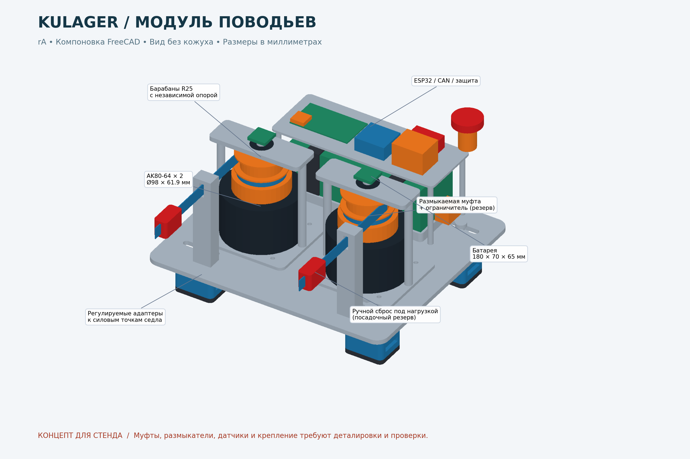

# Модуль Kulager — компоновка rA

Дата: 2026-10-05. Единицы CAD: мм. Это компоновочная сборка для проектирования
и стенда. Она не является комплектом деталей, готовым к изготовлению и установке
на животное. Функциональная безопасность муфт и крепления пока не подтверждена.



## Файлы и просмотр

- [Сборка FreeCAD](cad/assembly/kulager-module-rA-concept.FCStd): отдельные детали,
  группы, цвета, прозрачный кожух, таблица параметров.
- [Сборка STEP](exports/kulager-module-rA-concept.step).
- [Двухстраничный габаритный PDF](drawings/kulager-layout-rA-concept.pdf).
- [Параметры](cad/scripts/layout-parameters.json) и
  [генератор FreeCAD](cad/scripts/build-module.py).
- [Проверка геометрии](calculations/geometry-check-rA-concept.json) и
  [перечень объектов](calculations/cad-parts-rA-concept.csv).
- [Предварительная спецификация комплектующих](calculations/bom-rA-concept.csv).

В FreeCAD нажать `0` (аксонометрия), затем `V, F` (вписать всё).
Группа `06` содержит кожух: выделить его и нажать пробел для скрытия.
В группе `07` скрыта красная контрольная зона над холкой; она служит шаблоном
проверки, а не моделью анатомии. Для просмотра закрытого корпуса поставить
прозрачность `Guard` в 0. Ось X — поперёк, −Y — к голове, Z — вверх.

## Габариты и компоновка

| Узел | Принято в rA |
|---|---|
| Плита | 320 × 280 × 6, алюминий 6061, скругления R15 |
| Кожух | 326 × 286; стенка и крыша 3; пластик |
| Высота от нижней поверхности опор до кнопки | 218 |
| Расстояние между моторами | 144 |
| Моторы | два вертикальных габарита Ø98 × 61,9 |
| Барабаны | рабочий R25, ширина 18, фланцы Ø64 |
| Батарея | резерв 180 × 70 × 65; съёмная кассета с двумя стропами |
| Полка электроники | 220 × 83, над батареей, съёмная |
| Поперечное расстояние между опорами | номинально 230; плановая настройка 200…260 |
| Контрольный центральный просвет | ширина 140, высота до плиты 60; не критерий пригодности |

Батарея пока показана внутри корпуса, чтобы проверить полный габарит. Кассету
можно перенести в сумку у седла с отдельным защищённым жгутом. Это предпочтительно
при чрезмерном моменте на передних точках крепления; расположение сумки и
балансировка определяются по седлу. Внешняя установка отдельно в CAD не построена.

## Крепление

Нагрузка идёт от направляющих и приводов через плиту, проставки, две продольные
рейки и четыре адаптера к **силовым элементам ленчика седла**. Не крепить к коже,
декоративным кольцам или шее. Четыре опоры препятствуют повороту и опрокидыванию;
стропы изображены только как маршруты через проушины. Их концы, пряжки и ответные
анкеры зависят от седла и в этой ревизии отсутствуют. Требуется независимое
удержание самого модуля при ослаблении основного крепления, без петли вокруг шеи.

Пазы 48 × 8,5 под M8 позволяют смещать опоры. После настройки нужны механические
упоры от сдвига, а не только трение затяжки. Номинальные прокладки 6 мм работают
между рамой и седлом, а не между рамой и телом лошади. Геометрия накладок, их
углы и распределение давления требуют обмера. Раму нельзя считать подходящей
только потому, что она имеет просвет 140 мм: проверяются движения головы, шеи,
плеча, положение всадника и деформация седла под нагрузкой.

## Передача усилия

Каждый канал: мотор → **нормально разомкнутая при снятом питании муфта** →
механический ограничитель момента → отдельно опёртый барабан → тяговая лента →
датчик силы в направляющей → размыкатель под нагрузкой → отдельная ветвь повода.
Обычные ручные поводья всадника должны оставаться независимыми от привода.

Муфта включается только при аппаратном разрешении. При его исчезновении барабан
должен свободно отдавать ленту, независимо от редуктора. Выбирать именно муфту,
а не тормоз с пружинным замыканием. Резерв Ø70 × 20 в CAD **не означает, что
подходящее изделие уже найдено**; выбор может существенно изменить высоту.
Муфта и входная часть защиты рассчитываются с учётом возможного полного момента
AK80-64 при неисправности, а не только малого рабочего момента.

Барабан с лентой 15 мм даёт почти постоянный радиус при ходе менее оборота.
Начальный стендовый ход 80 мм соответствует 183,3°. Проверить удержание ленты,
реальный радиус с учётом её толщины, минимальный остаточный виток/заделку и
отсутствие второго слоя. В CAD лента показана прямолинейно: намотка, заделка,
подвижные состояния и внутреннее устройство муфт ещё не детализированы.
Возвратная пружина, постоянно подтягивающая повод, не предусматривается.

Красные детали на выходах — **только резервы под механические размыкатели**.
Они должны открываться под нагрузкой общей доступной рукояткой с двумя тросами;
тросы и кинематика рукоятки ещё не разработаны. Размыкатель располагается после
всех возможных мест заклинивания привода. Отсоединяемая ветвь не должна образовать
длинную свободную петлю. Простое кольцо/карабин не считается таким устройством.

Датчики натяжения нужны отдельно на каждом канале. Прямой проход ленты через
жёсткое отверстие не измеряет силу: требуется выбранный измерительный ролик с
калиброванным углом охвата либо последовательный датчик. В CAD показаны только
занимаемый объём и стойки. Энкодер нужен **после муфты**, поскольку положение
вала двигателя при проскальзывании и размыкании не определяет длину повода.

## Электроника и питание

Под полкой находится батарея, над ней — резервы ESP32 с CAN-трансивером,
усилителями датчиков, DC/DC, предохранителем и аппаратной цепью разрешения.
Плата 78 × 45 — габаритный резерв, не готовая разводка. Для антенны предусмотрена
зона под пластиковым кожухом; окончательная зона отсутствия меди и металла берётся
из документации выбранного модуля ESP32. Силовой жгут разнести с аналоговыми
датчиками, кабели закрепить от перетирания и натяжения.

E-stop разрывает разрешение муфт и силового контактора независимо от ESP32.
Сторожевой аппаратный таймер также снимает разрешение. Логика может оставаться
запитанной до главного выключателя для регистрации причины отказа. Предусмотреть
контроль фактического размыкания, предзаряд, подавление выбросов, защиту от
переполюсовки и рекуперации; см. [питание](../electrical/power/concept-rA.md).

## Кожух и обслуживание

Пластиковый кожух закрывает вращающиеся детали, края скруглены в плане. Два
передних окна пропускают тяговые ленты; необходимы сменные мягкие щётки/манжеты
от шерсти. Крыша даёт запас над энкодерами, E-stop доступен сверху справа.
В окончательной конструкции нужны невыпадающие винты крышки, усиленные бобышки,
уплотнение, кабельные вводы, дренаж вниз и вентиляционная мембрана. Они ещё не
смоделированы, степень IP не заявляется. Тепло моторов уводить на алюминиевую
плиту с защитой от контакта с человеком и лошадью.

Батарею снимать после размыкания главного питания. Заряжать отдельно от седла.
Для доступа к ней снимается кожух и полка электроники; полка должна иметь
разъёмный жгут с маркировкой. Проверить доступ инструмента, радиусы изгиба и
зазоры разъёмов после выбора реальных комплектующих.

## Что необходимо до рабочей ревизии

1. Обмер седла, массы и плеча нагрузки, разрешённые точки крепления.
2. Получить точный STEP/чертёж именно имеющейся ревизии AK80-64: текущие моторы
   — габариты, интерфейсная сверловка адаптеров намеренно не выдумана.
3. Выбрать и испытать муфты, ограничители, размыкатели и измерители натяжения.
4. Разработать все силовые соединения, подшипниковые посадки, заделку ленты,
   крепления стоек, герметизацию и трассы жгутов. Показанные стойки задают путь
   нагрузки, но полный крепёж и резьбы ещё не рассчитаны.
5. Уменьшить массу по результатам расчёта; выполнить расчёт прочности и усталости,
   проверить крепление на макете седла. FEM в rA не выполнялся.
6. Пройти [стендовые критерии](../docs/safety/test-gates.md). Животное не заменяет
   стенд; значения усилий в этой ревизии не являются допустимыми для лошади.

## Воспроизводимость

В Python Console FreeCAD выполнить (подставить путь к репозиторию):

```python
path = '/путь/к/Kulager/mechanical/cad/scripts/build-module.py'
exec(compile(open(path).read(), path, 'exec'), {'__file__': path})
```

Скрипт пересоздаёт документ `KulagerModule` и его выходные файлы, поэтому сначала
сохранить ручные правки под другим именем. Размеры задаются JSON. Таблица FreeCAD
содержит их снимок; изменение ячеек не перестраивает тела. Это BRep-сборка из
отдельных именованных объектов, а не сборка с кинематическими связями.
После изменения JSON повторить генерацию и проверки. Рендер PNG/PDF:
`python3 mechanical/cad/scripts/render-layout.py` (нужны numpy и matplotlib).

## Источники

- [CubeMars AK80-64](https://www.cubemars.com/goods.php?id=1143): габариты,
  масса, момент, обратное проворачивание и варианты номинального напряжения.
- [ESP32 TWAI, Espressif](https://docs.espressif.com/projects/esp-idf/en/v5.4/esp32/api-reference/peripherals/twai.html):
  CAN-контроллер и внешний трансивер.

Данные проверены 2026-10-05. Прочие размеры — проектные предположения rA.
