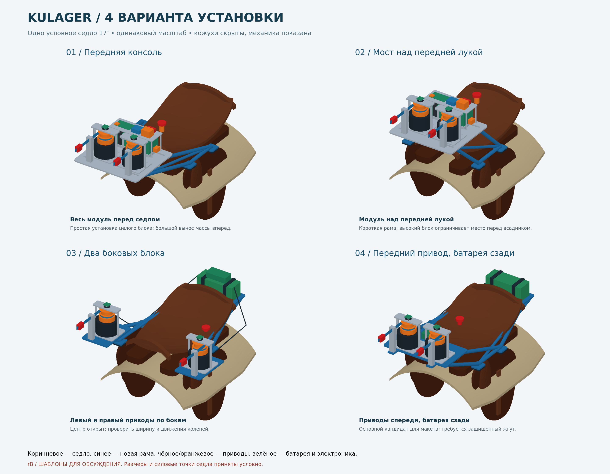

# Четыре шаблона установки модуля на седло — rB

Дата: 2026-10-08. Сделаны четыре самостоятельные сборки **FreeCAD с седлом,
креплением и модулем**, а также общая сборка для сравнения. Размеров реального
седла нет, поэтому эти модели предназначены для выбора компоновки и примерки
на будущий обмер. Исходная механика rA сохранена отдельно.



## Что открыть

- [Все четыре варианта в одном FreeCAD-файле](cad/assembly/saddle-templates/saddle-comparison-rB-templates.FCStd).
- [Сравнение и четыре листа с видами сбоку и сверху — PDF](drawings/saddle-templates/saddle-options-rB-templates.pdf).
- [Отдельное седло без оборудования](cad/assembly/saddle-templates/saddle-reference-17in-rB-templates.FCStd).

| Вариант | FreeCAD | STEP | Изображение |
|---|---|---|---|
| 01 — Передняя консоль | [FCStd](cad/assembly/saddle-templates/v1-front-console-rB-templates.FCStd) | [STEP](exports/saddle-templates/v1-front-console-rB-templates.step) | [PNG](drawings/saddle-templates/v1-front-console-rB-templates.png) |
| 02 — Мост над передней лукой | [FCStd](cad/assembly/saddle-templates/v2-pommel-bridge-rB-templates.FCStd) | [STEP](exports/saddle-templates/v2-pommel-bridge-rB-templates.step) | [PNG](drawings/saddle-templates/v2-pommel-bridge-rB-templates.png) |
| 03 — Два боковых блока | [FCStd](cad/assembly/saddle-templates/v3-side-pods-rB-templates.FCStd) | [STEP](exports/saddle-templates/v3-side-pods-rB-templates.step) | [PNG](drawings/saddle-templates/v3-side-pods-rB-templates.png) |
| 04 — Передний блок + задняя батарея | [FCStd](cad/assembly/saddle-templates/v4-front-rear-battery-rB-templates.FCStd) | [STEP](exports/saddle-templates/v4-front-rear-battery-rB-templates.step) | [PNG](drawings/saddle-templates/v4-front-rear-battery-rB-templates.png) |

## Принятые размеры седла

За основу выбран узнаваемый тип **универсального английского седла 17″**:
сиденье, передняя и задняя луки, два крыла, коленные упоры, подушки и вальтрап.
Это собственный геометрический шаблон, а не модель конкретного производителя.

| Параметр | Принято | Основание |
|---|---:|---|
| Обозначение размера сиденья | 17″ / 43 см | Размерная линейка Wintec |
| Наружная длина модели седла | 470 мм | Проектное допущение |
| Ширина опорного сечения сиденья | 300 мм | Проектное допущение |
| Вальтрап | 540 × 460 мм | Проектное допущение |
| Нижняя контрольная точка крыла | Z = −265 мм | Проектное допущение; сглаженная поверхность немного выходит за неё |
| Поперечная база адаптеров | 350 мм | X = ±175 мм, проектное допущение |
| Продольная база адаптеров | 165 мм | Y = 60 и 225 мм, проектное допущение |
| Высота верхней поверхности адаптеров | Z = 80 мм | Проектное допущение |
| Батарея | 180 × 70 × 65 мм | Резерв из rA, не выбранное изделие |

17″ **не означает наружную длину седла 430 мм** и не задаёт ширину ленчика.
Даже одинаково обозначенные размеры седел разных моделей могут отличаться.
Источники: [размеры сиденья Wintec](https://wintecsaddles.us/pages/measuring-your-seat-size),
[пояснение Bates о различиях размеров](https://batessaddles.com.au/pages/measuring-your-seat-size).
Все размеры крепления, кроме обозначения размера сиденья, выбраны для шаблона,
а не выданы за единый стандарт.

Система координат отдельных сборок: X — поперёк седла, +Y — к задней луке,
−Y — к голове, Z — вверх. Передний край сиденья расположен при Y = 0,
задний — Y = 470. Z = 0 — условная плоскость модели, не поверхность спины.

## 01. Передняя консоль

Цельный модуль rA, включая батарею, вынесен перед передней лукой. Две боковые
продольные связи и треугольные подкосы передают нагрузку на четыре адаптера
к ленчику. Под основанием расположены два ложемента для съёмного модуля.

- Кожух 326 × 286 мм; центр блока Y = −175 мм; низ несущей плиты Z = 170 мм.
- Преимущество: можно использовать исходный модуль целиком, короткая внутренняя проводка.
- Недостаток: большой вынос всей массы вперёд; проверить изгибающий момент,
  раскачивание и движения шеи. Этот вариант полезен как исходный вариант для сравнения.

## 02. Мост над передней лукой

Тот же модуль поднят на мостовой раме над передней лукой. Передние и задние
подкосы идут к тем же четырём точкам седла, поэтому варианты можно сравнивать
без смены базовых точек крепления.

- Центр блока Y = 20 мм; низ плиты Z = 210 мм; верх кнопки около Z = 376 мм.
- Преимущество: меньше продольный вынос относительно седла.
- Недостаток: высокий центр масс и занятое пространство перед всадником.
  **Проверка выявляет заход блока в условную зону всадника** — он сохранён как
  наглядный недостаток варианта, а не скрыт изменением контрольной зоны.

## 03. Два боковых блока

Моторы с барабанами разнесены влево и вправо, каждый находится на собственной
полке с кожухом. Батарея и электроника расположены за задней лукой. Кабели идут
вдоль наружных сторон седла; маршруты показаны тёмными линиями.

- Оси приводов X = ±235 мм, Y = 50 мм; ширина по кожухам **602 мм**.
- Преимущество: пространство по центру перед седлом открыто, приводы ниже.
- Недостаток: блоки выступают по бокам. Нужна проверка коленей, посадки/спешивания
  и зацепов; широкая конструкция может оказаться неприемлемой для конкретного седла.
- Скрытая центральная зона всадника не моделирует колени: отсутствие пересечения
  с ней не доказывает удобство бокового варианта.

## 04. Компактный передний блок, батарея за седлом

Спереди оставлены два привода и небольшой отсек ESP32/CAN, батарея перенесена
на отдельную полку за задней лукой. Передняя плита укорочена, но имеет выступы
под опоры направляющих лент. Задняя полка связана подкосами с боковыми адаптерами;
на рисунке виден маршрут защищённого силового жгута.

- Передний кожух **326 × 176 мм**; центр по исходной системе блока Y = −70 мм;
  низ передней плиты Z = 170 мм.
- Задняя батарея занимает X = −90…90, Y = 502…572, Z = 138…203 мм.
- Преимущество: меньший объём спереди и перенос массы батареи назад.
- Недостаток: два места обслуживания, дополнительный жгут и задние подкосы;
  проверить свободное место за всадником и крепление задней полки.

**Для первого габаритного макета предлагаю вариант 04.** Это предпочтение по
компоновке: уменьшен передний корпус и освобождена зона сиденья. Прочность,
динамическая устойчивость и окончательный баланс массы ещё не подтверждены.
Вариант 01 остаётся альтернативой, если важнее установка существующего блока
без перекомпоновки. Варианты 02 и 03 позволяют оценить другие ограничения на макете.

## Что именно изображает крепление

Синие детали — предлагаемая рама и адаптеры, тёмные прокладки — контактные
накладки между адаптером и седлом. Адаптеры должны соединяться с силовой частью
ленчика через подобранную по обмеру ответную деталь. Их расположение возле крыла
не означает допустимость крепления только к коже. Крылья и коленные упоры показаны,
чтобы оценить взаимное расположение; силовая структура конкретного седла неизвестна.

Подкосы сейчас представлены сплошными цилиндрическими габаритами, а не выбранными
трубами с рассчитанными стенками. Стыки, защёлки быстросъёма, полный крепёж и
усиления не разработаны. Моторы и механика перенесены из rA; муфты и датчики
остаются габаритными резервами. Это 3D-шаблоны, не производственные чертежи.

## Просмотр, изменение, проверки

В FreeCAD: `0` — аксонометрия; `V, F` — вписать в окно. В каждом файле есть
группы седла, крепления, механизмов, батареи, кожухов и маршрутов кабелей.
Кожухи полупрозрачны. Чтобы скрыть группу, выделить её и нажать пробел.
В сравнительной сборке четыре варианта разнесены по сетке 1000 × 1300 мм.
Перемещение по этой сетке служит только для показа, не является размером установки.

В группе `07` скрыты условные объёмы всадника и холки. Их можно включить для
проверки компоновки. Это прямоугольные контрольные зоны, не анатомические модели.
Проверка не включает движения животного, коленей и наклоны корпуса всадника.

Геометрия генерируется из
[saddle-templates-parameters.json](cad/scripts/saddle-templates-parameters.json).
Числа в таблице FreeCAD — снимок допущений, не управляющие выражения. Менять
размеры нужно в JSON и повторно запускать
[build-saddle-templates.py](cad/scripts/build-saddle-templates.py).
Параметры меняют указанные опорные размеры; это не универсальная система
автоматической подгонки седла. После изменений нужны новые проверки зазоров.

В Python Console FreeCAD выполнить (подставить путь к репозиторию):

```python
path = '/путь/к/Kulager/mechanical/cad/scripts/build-saddle-templates.py'
exec(compile(open(path).read(), path, 'exec'), {'__file__': path})
```

Выходные rB-файлы перезаписываются, поэтому ручные варианты сначала сохранить
под другими именами. Генератор читает существующий rA, не изменяя его.
PNG/PDF обновляет `python3 mechanical/cad/scripts/render-saddle-templates.py`
(numpy, matplotlib). Чертежи показаны без кожухов для видимости внутренней компоновки.

[Отчёт геометрии](calculations/saddle-templates-check-rB-templates.json)
содержит валидность тел и пересечения оборудования с условным седлом.
Намеренные соединения рамы, посадка контактных накладок и все пары деталей
между собой этой проверкой не оцениваются. Отдельно проверяется повторное
открытие FCStd и совпадение суммарного объёма с STEP:
[отчёт проверки файлов](calculations/saddle-templates-roundtrip-rB-templates.json).
